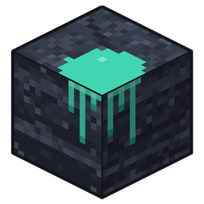

<p align="center">
  
</p>

<h1 align="center">Deepslate Studio</h1>

<p align="center">Editor de skins de escritorio, rápido, sin cuenta y sin publicidad.<br>Para Linux y Windows.</p>

---

## Funciones

### Edición
- **Lienzo 2D:** la textura desplegada, editable píxel a píxel, con cuadrícula opcional y el nombre de cada parte.
- **Pintar en 3D:** el lápiz, el borrador, el bote y el cuentagotas también funcionan sobre el personaje en 3D, con el píxel bajo el cursor resaltado. Se gira con el botón derecho y se acerca con la rueda.
- **Herramientas:** lápiz, borrador, bote de pintura, cuentagotas, degradado, sello y selección rectangular.
- **Espejo:** lo que pintas en un brazo o una pierna se copia al lado opuesto. Funciona para todo el cuerpo o solo para la parte elegida.
- **Capas:** capa base y capa exterior. Cada parte y cada capa se puede mostrar u ocultar por separado.
- **Deshacer y rehacer** en todas las operaciones.

### Colores
- Selector con código hex (`#RRGGBB` o `#RRGGBBAA`) y color secundario para degradados.
- Colores usados hace poco, siempre a mano.
- Paleta propia con nombres.
- Importación de paleta desde cualquier imagen o skin.

### Modelos y partes
- **Steve y Alex** (brazos de 4 y 3 píxeles), con conversión y vista de antes y después.
- **Skins antiguas de 64×32:** se abren y se convierten solas al formato 64×64.
- **Copiar y pegar partes** entre skins, eligiendo cuáles entran.

### Vista 3D y poses
- Poses: de pie, caminando, saludando, brazo arriba, agachado, corriendo, combate y neutra. La pose se guarda con la skin.
- Fondo, iluminación, sombra en el suelo y velocidad de giro configurables.
- **Captura** de la vista 3D a PNG con fondo transparente.

### Vista previa
- Muestra la skin sobre un maniquí, la skin actual u otra skin cargada.
- Capa en la espalda, de un color o desde una imagen tuya. Lo que cargas ahí no se guarda.

### Archivos
- El proyecto es un **PNG normal**: lo abre cualquier visor de imágenes y lo acepta el juego. El modelo y la pose van guardados dentro del PNG.
- **Exportar rápido** a una carpeta fija, con plantilla de nombre (`{name}`, `{model}`).
- Abre la última skin al iniciar y tiene autoguardado (opcional).

### Ajustes
- Atajos de teclado editables, con aviso si una combinación ya está en uso.
- Tema claro, oscuro o del sistema, tamaño de píxel, niveles de deshacer, vista y herramienta al iniciar.
- Registro de errores visible desde la propia app.

## Descargas

Vamos a publicar versiones listas para usar en Linux y Windows en la sección **Releases** del repositorio. Serán las primeras versiones (0.x): ya se pueden usar, pero todavía puede haber errores y algunas cosas pueden cambiar de una versión a otra. Los proyectos guardados se seguirán abriendo en las versiones nuevas.

- **Windows:** descomprime el `.zip` y abre `deepslate-studio.exe`.
- **Linux:** descomprime el `.tar.gz` y abre `deepslate-studio`. Para que aparezca en el menú de aplicaciones con su ícono:

  ```sh
  install -Dm755 deepslate-studio ~/.local/bin/deepslate-studio
  install -Dm644 deepslate-studio.png ~/.local/share/icons/hicolor/256x256/apps/deepslate-studio.png
  install -Dm644 deepslate-studio.desktop ~/.local/share/applications/deepslate-studio.desktop
  ```

Si encuentras un error o tienes una idea, abre un *issue*.

## Instalar desde el código

Hace falta Rust estable 1.95 o más nuevo ([rustup](https://rustup.rs)).

```sh
git clone <url-del-repositorio>
cd deepslate-studio
cargo run --release
```

La vista 3D usa la GPU (Vulkan, DirectX u OpenGL). Si no hay ninguna disponible, el editor 2D sigue funcionando.

## Dónde guarda sus datos

| | Linux | Windows |
|---|---|---|
| Ajustes | `~/.config/deepslate-studio/` | `%APPDATA%\deepslate-studio\config\` |
| Registro | `~/.local/share/deepslate-studio/` | `%APPDATA%\deepslate-studio\data\` |

Las rutas exactas aparecen en **Ajustes → Avanzado**.

## Idiomas

Español, inglés, portugués de Brasil y catalán. La app usa el idioma del sistema, y se puede cambiar en **Ajustes → General** sin reiniciar.

## Contribuir

```sh
cargo test
cargo clippy --all-targets -- -D warnings
cargo fmt --check
```

La CI ejecuta lo mismo en Linux y en Windows. Las reglas del proyecto están en [`CLAUDE.md`](CLAUDE.md).

## Licencia

[GPLv3](LICENSE).

La fuente de los títulos es [Pixelify Sans](https://github.com/eifetx/Pixelify-Sans), con licencia [SIL Open Font License 1.1](assets/fonts/OFL.txt).

Deepslate Studio es un proyecto independiente. No está afiliado a Mojang ni a Microsoft, ni cuenta con su aprobación.
